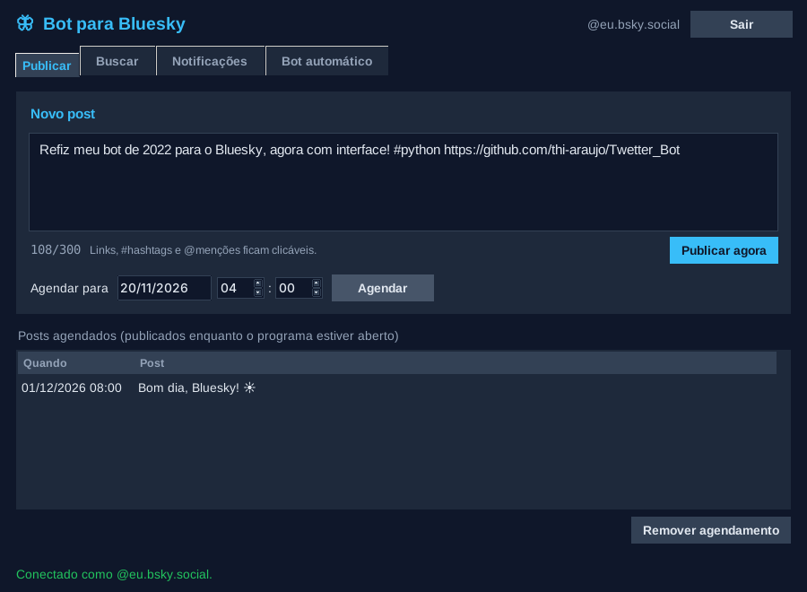
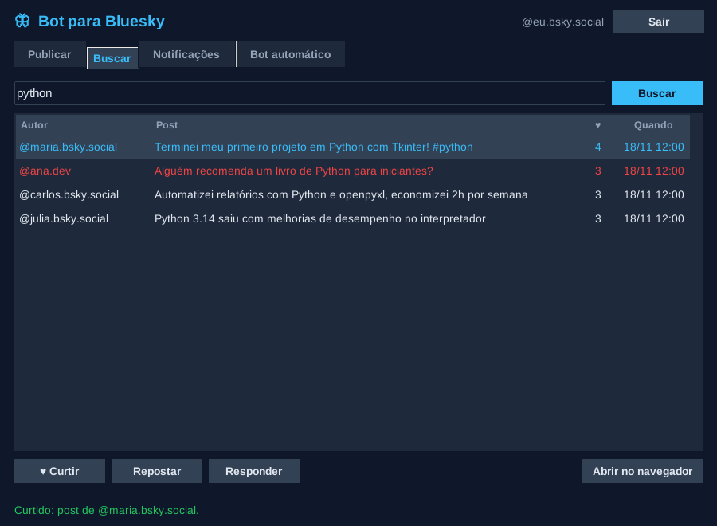
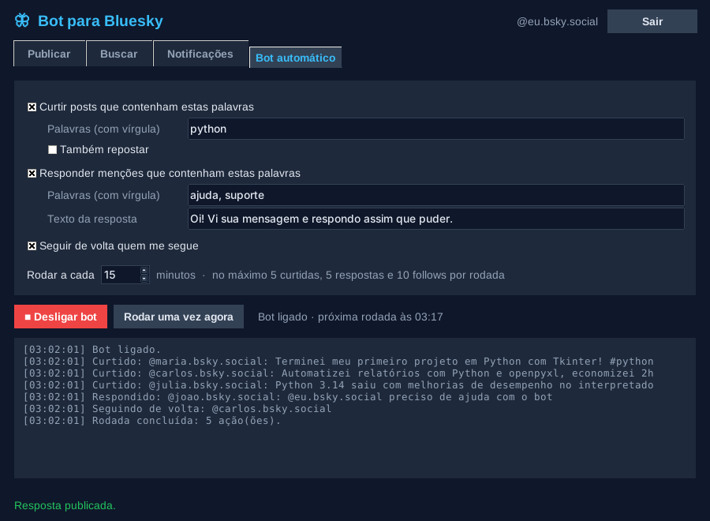

# Bot para Bluesky

Aplicativo com interface gráfica para publicar, agendar, buscar e automatizar ações numa conta do [Bluesky](https://bsky.app). Funciona no **Windows, Linux e macOS** e não precisa instalar nenhuma biblioteca: só Python.

| Publicar e agendar | Buscar | Bot automático |
|---|---|---|
|  |  |  |

## Funcionalidades

**Publicar**
- Contador de caracteres com o limite do Bluesky (300).
- Links, `#hashtags` e `@menções` viram clicáveis no post.
- **Agendar** posts para data e hora escolhidas. Eles ficam salvos e são publicados enquanto o programa estiver aberto.

**Buscar**
- Pesquisa posts por palavra e mostra autor, texto, curtidas e data.
- **Curtir**, **repostar**, **responder** ou abrir o post no navegador.

**Notificações**
- Curtidas, reposts, novos seguidores, menções e respostas, com as novas destacadas.
- **Responder**, **curtir** ou **seguir de volta** direto da lista.

**Bot automático**, as mesmas ideias dos bots de 2022 para o Twitter:
- **Curtir** (e, se quiser, **repostar**) posts que contenham certas palavras.
- **Responder** menções que contenham certas palavras com um texto pronto.
- **Seguir de volta** quem segue a conta.
- Roda a cada N minutos (mínimo 5), com limite de ações por rodada para não parecer spam. Nunca age duas vezes no mesmo post, mesmo depois de fechar e abrir o programa.

## Requisitos

- Python 3.9 ou mais novo, com Tkinter (já vem no instalador oficial do Windows e do macOS).
  - No Ubuntu/Debian, se faltar: `sudo apt install python3-tk`
- Uma conta no Bluesky e uma **senha de app** (veja abaixo).

## Como usar

1. No Bluesky, vá em **Configurações → Privacidade e segurança → Senhas de app** e crie uma senha (ex.: "Bot Python"). Ela tem o formato `xxxx-xxxx-xxxx-xxxx`.
2. Rode o programa:

   ```bash
   git clone https://github.com/thi-araujo/Twetter_Bot.git
   cd Twetter_Bot
   python bot_bluesky.py
   ```

   No Linux/macOS, use `python3`.
3. Entre com seu usuário (`fulano.bsky.social`) e a senha de app.

> **Use sempre uma senha de app, nunca a senha principal.** A senha de app pode ser revogada a qualquer momento sem afetar a conta. O programa não grava a senha em disco: salva só o nome de usuário, as regras do bot e os posts agendados, em `~/.bluesky_bot.json`.

Para não digitar o login toda vez, defina as variáveis de ambiente `BLUESKY_USUARIO` e `BLUESKY_SENHA_APP` antes de abrir o programa.

### Use com responsabilidade

Automação agressiva viola as [diretrizes da comunidade do Bluesky](https://bsky.social/about/support/community-guidelines) e pode levar à suspensão da conta. Mantenha intervalos longos, palavras específicas e respostas que façam sentido.

## Estrutura do projeto

```
Twetter_Bot/
├── bot_bluesky.py        # interface gráfica (Tkinter)
├── bluesky.py            # cliente da API do Bluesky (AT Protocol), só com urllib
├── automacao.py          # regras do bot, agendamentos e configuração
├── tests/
│   ├── servidor_falso.py # servidor Bluesky simulado para os testes
│   ├── test_bluesky.py
│   └── test_automacao.py
└── docs/                 # capturas de tela usadas neste README
```

O cliente pode ser usado sozinho:

```python
from bluesky import ClienteBluesky

cliente = ClienteBluesky()
cliente.entrar("fulano.bsky.social", "xxxx-xxxx-xxxx-xxxx")
cliente.publicar("Olá, Bluesky! #python")
for post in cliente.buscar_posts("python", limite=5):
    print(post.autor_handle, post.texto)
```

## Testes

Os testes usam um servidor Bluesky simulado, então rodam sem internet e sem conta:

```bash
python -m unittest discover -s tests -v
```

## Histórico

Em 2022 este repositório era um conjunto de exemplos com a biblioteca **tweepy** para a API v1.1 do Twitter: publicar, ler a timeline, buscar, curtir, ver tendências, streaming e bots de follow, curtida/retweet e resposta automática.

Em 2023 o Twitter virou X e mudou a API. Leitura, busca e streaming passaram a exigir plano pago (a partir de US$ 200/mês), e a versão 4 do tweepy removeu várias das classes usadas. Por isso, em 2026 o projeto foi refeito para o Bluesky, cuja API é aberta e gratuita, mantendo as mesmas ideias de bot, agora com interface gráfica, agendamento e testes. O nome do repositório ficou o mesmo para manter o histórico.

## Autor

**Thiago Gomes Araújo**: [GitHub](https://github.com/thi-araujo) · [Portfólio](https://thi-araujo.github.io)
